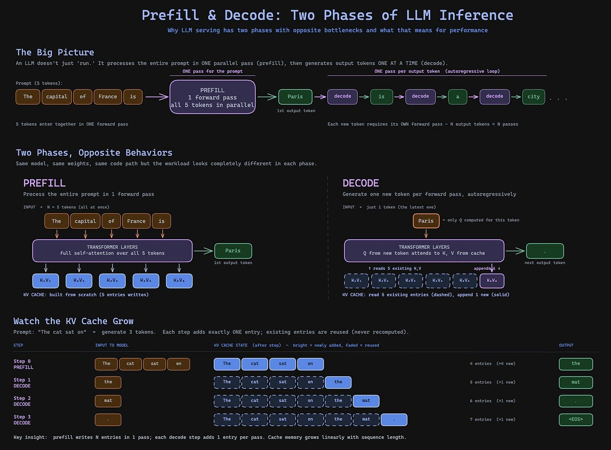
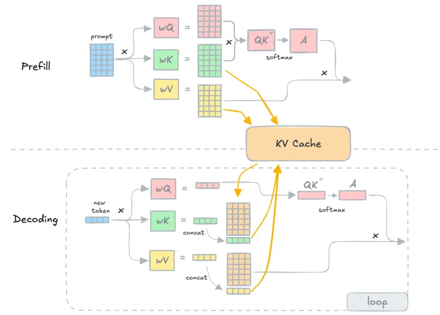
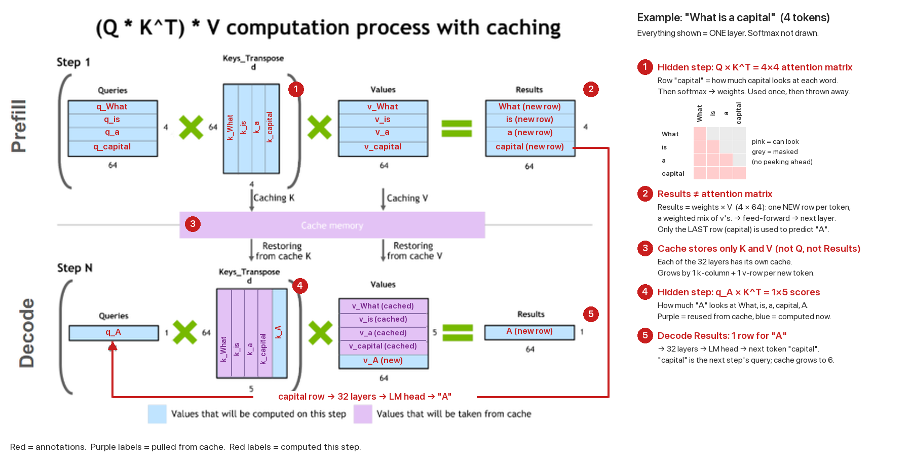
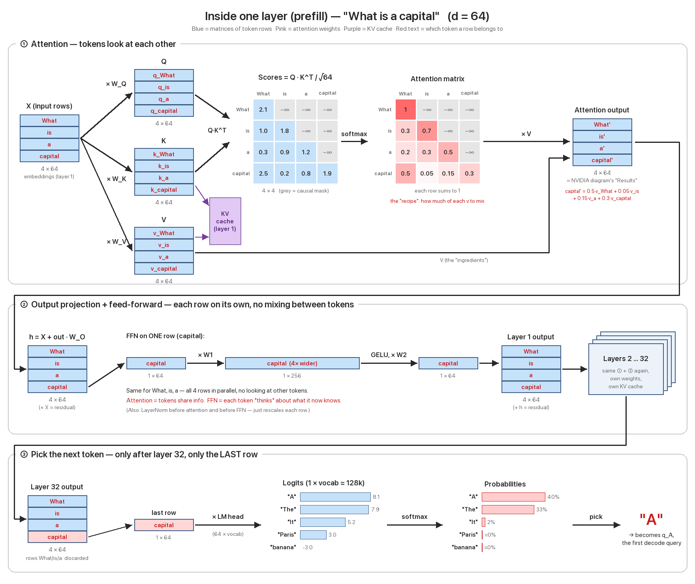

# Prefill / Decode

https://www.youtube.com/watch?v=3SBUCJzogj4

**Annotated** — same diagram with the example ("What is a capital", 4 tokens) filled in:

**Full layer** — every step the diagram above skips (attention matrix, feed-forward, 32 layers, picking the next token):

**Example**: What is a capital?

## Prefill

Simply put, you can think of it like each word ("What", "is", "a", "capital") is a row in the $Q$ & $K^T$ matrices.

With a longer sentence, you can see that the matrices grow, which means bigger matrix computation needs to be done.

**Note**: Since this is a matrix, each word's computation can be done in parallel.

## Decode

