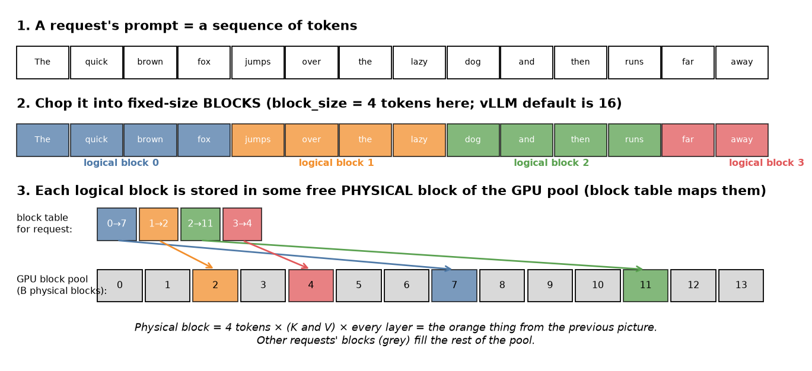
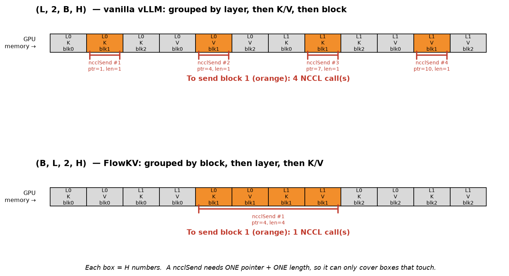
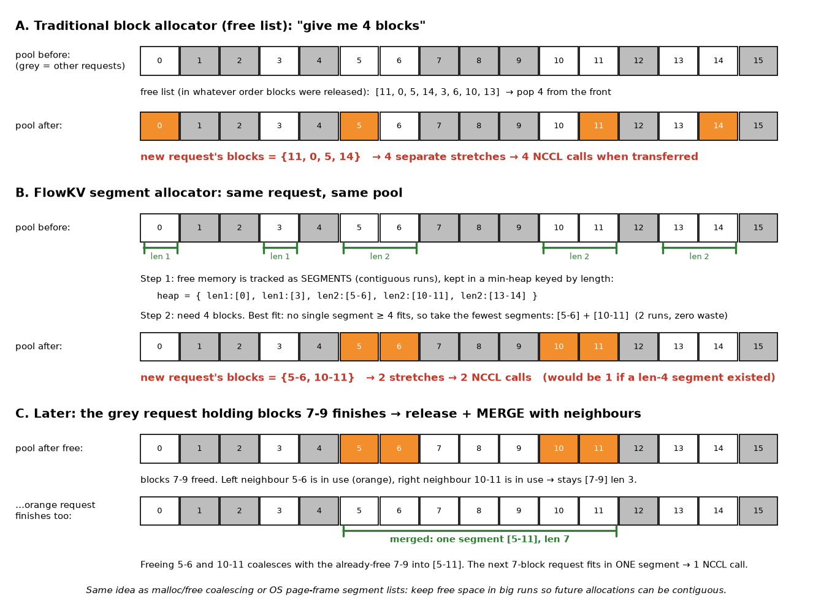
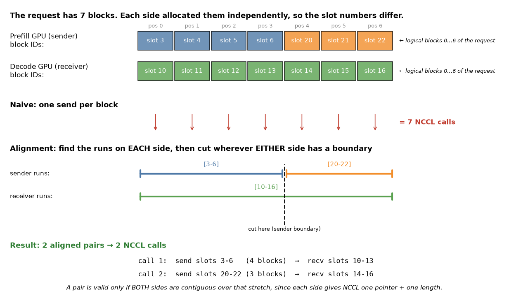

# FlowKV

**FlowKV** makes KV-cache transfer between prefill and decode GPUs fast by making the number of NCCL calls tiny — one call per big contiguous chunk instead of one per layer per block.

Source: Li et al., 2025, `arXiv:2504.03775` — *FlowKV: A Disaggregated Inference Framework with Low-Latency KV Cache Transfer and Load-Aware Scheduling*. Claims ~96% lower KV transfer latency. These notes cover only the KV transfer part (Section on KV cache transfer optimizations), not the load-aware scheduler.

## The problem
- In disaggregated inference, prefill runs on one GPU and decode on another — the KV cache has to be shipped between them for every request.
- The shipping is done with NCCL `send`/`recv`. The API is just a start address and a length:

  ```c
  ncclSend(void* ptr, size_t count, ...)   // "send `count` elements starting at `ptr`"
  ncclRecv(void* ptr, size_t count, ...)   // "write `count` elements starting at `ptr`"
  ```

  There is no "send these 64 scattered pieces" form. If the data sits in 64 separate places in memory, that is 64 calls, each with its own pointer. **Number of NCCL calls = number of separate contiguous stretches.**
- Each call also has a fixed launch cost (microseconds), regardless of size. Thousands of tiny calls → latency dominated by overhead, not bytes.
- Vanilla vLLM needs `2 × L` calls **per block** (one per layer, for K and for V). A 32-layer model with a 2k-token prompt (~125 blocks) → ~8,000 calls.

## What is a block?


- PagedAttention chops a request's token sequence into fixed-size **blocks** (default 16 tokens).
- The GPU has one shared pool of `B` physical block slots. A request's blocks can land in *any* free slots — a per-request **block table** records "my logical block 2 is in physical slot 11".
- One physical block = K and V for 16 tokens, for **every** layer.
- Same idea as OS virtual memory pages → "paged" attention.

## Optimisation 1: reshape the cache so a block is one contiguous chunk


- The KV cache is a 4-D array. The axis order decides what is contiguous in memory — **whatever axis is first can be sliced off as one chunk**.
- `(L, 2, B, H)` — vanilla vLLM. Grouped by layer, then K/V, then block. Block `b` is scattered into `2L` separate strips.
- `(B, L, 2, H)` — FlowKV. Grouped by block first. Block `b` is one run of `L × 2 × H` numbers.

| axis | meaning |
|---|---|
| `L` | which transformer layer |
| `2` | K (0) or V (1) |
| `B` | which block slot in the pool |
| `H` | the payload: `block_size × num_kv_heads × head_dim` numbers |

- Example: 2 layers, 3 blocks. Old layout → block 1 is 4 strips → 4 `ncclSend`. New layout → 1 strip → 1 `ncclSend`.
- Result: **calls per block drop by `L × 2`** (64× for a 32-layer model). Same bytes, same data — just a different nesting order.
- Cost: the PagedAttention kernel assumed the old strides, so it has to be patched.

## Optimisation 2: segment allocator (consecutive slots per request)


Now one block = one call, but a request still has many blocks. If its slots are **consecutive** (`7, 8, 9, 10` instead of `7, 2, 11, 4`), several blocks can go in one call because block is the outermost axis. The allocator decides this.

- **Old way (free list):** new request pops whatever slots were released most recently → scattered, e.g. `{11, 0, 5, 14}` → 4 calls.
- **FlowKV way (segments):** borrowed from OS memory management / `malloc`.
  1. Track free **runs** (segments) instead of individual blocks — "5-6 free, 10-11 free".
  2. Keep segments in a **min-heap keyed by length** → "smallest segment that fits" is cheap.
  3. **Allocate best-fit:** pick the smallest segment ≥ N. If none fits, use the fewest segments that add up to N. Example: need 4, segments are len 1,1,2,2,2 → take `[5-6] + [10-11]` = 2 runs.
  4. **On free, merge with neighbours:** freed `7-9` + later-freed `5-6` and `10-11` → one segment `[5-11]`. Keeps big runs available.
- "Minimise waste" = best-fit avoids carving a small request out of a big segment and leaving an awkward remnant.

## Optimisation 3: bidirectional segment alignment


- Sender and receiver allocated **independently**, so even with contiguous runs on each side, the run boundaries differ.
- A merged send/recv is only valid where the stretch is contiguous on the sender **and** on the receiver (each side gives NCCL one pointer + one length).
- Algorithm: walk the two block-ID lists position by position, **cut wherever either side's run ends**. Each piece between cuts = one NCCL send/recv pair.
- Example: sender `[3-6], [20-22]`, receiver `[10-16]`. One cut at position 4 → 2 calls instead of 7.
  - call 1: send slots 3-6 → recv slots 10-13
  - call 2: send slots 20-22 → recv slots 14-16
- "Bidirectional" = cuts come from both lists. If receiver had been `[10-11], [12-16]`, add a cut at position 2 → 3 calls.

## TL;DR
| step | what it fixes | NCCL calls to move N blocks |
|---|---|---|
| vanilla vLLM | — | `N × 2L` |
| 1. reshape `(L,2,B,H) → (B,L,2,H)` | one block = one chunk | `N` |
| 2. segment allocator | blocks consecutive on each GPU | a few runs |
| 3. segment alignment | runs line up across both GPUs | `#aligned runs` (ideally 1–3) |

All three attack the same thing: many tiny NCCL launches with fixed overhead, not bandwidth.

## Related
- `Work/Megatron/disaggregated-inference.md` — the prefill/decode split that makes KV transfer necessary
- `Machine_Learning/LLMs/Inference/prefill-decode.md` — what prefill and decode are
- `GPU_Concepts/tensors.md` — axis order and memory layout background
- `Machine_Learning/Research_Papers/papers-read.md` — index of papers
