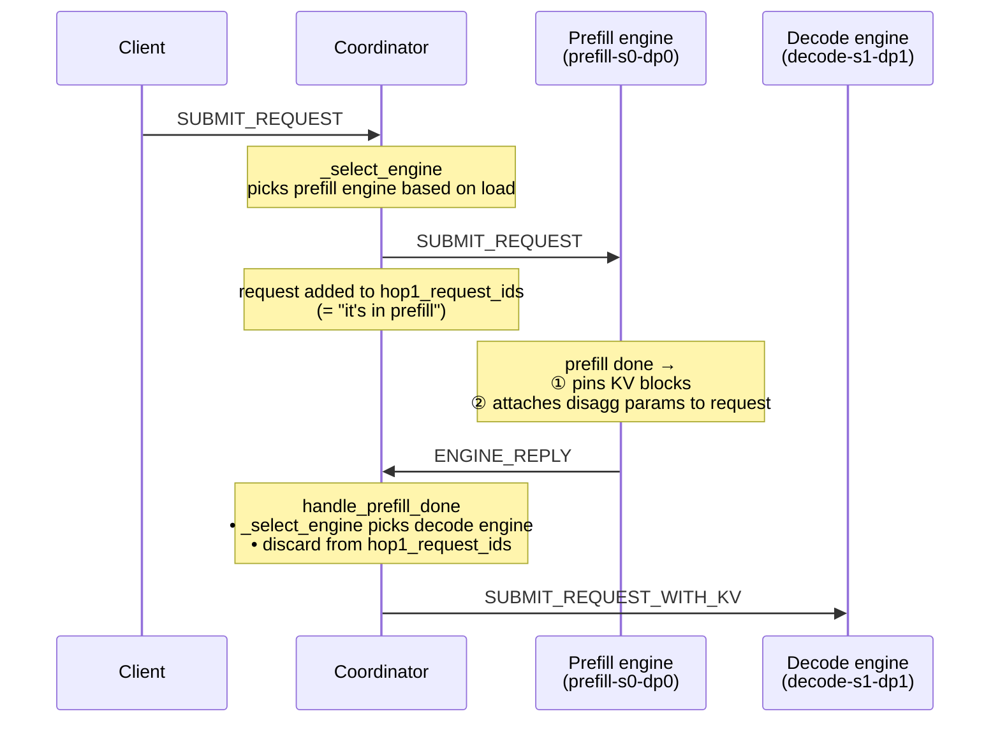
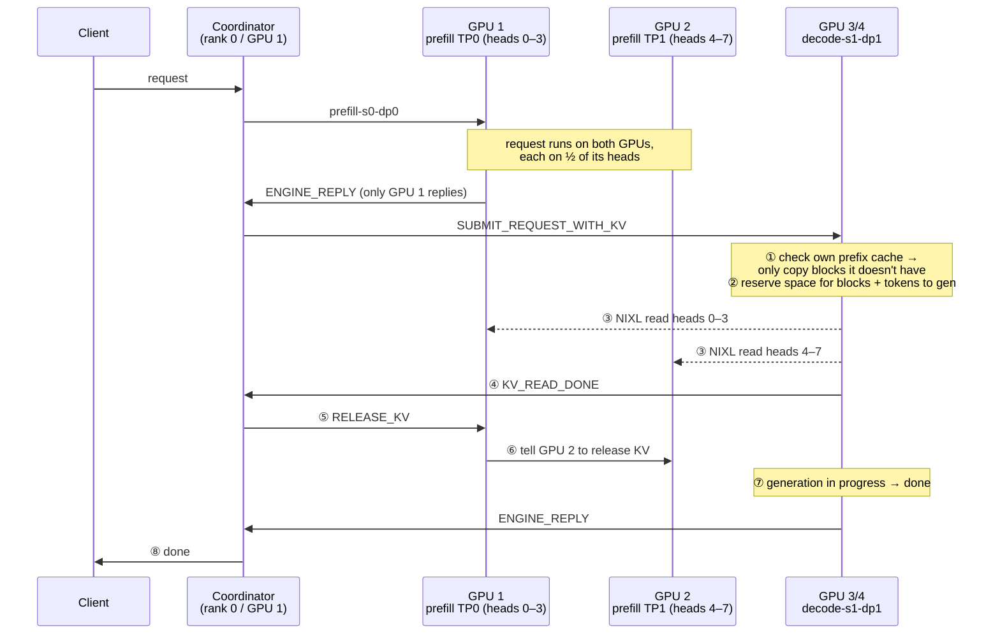
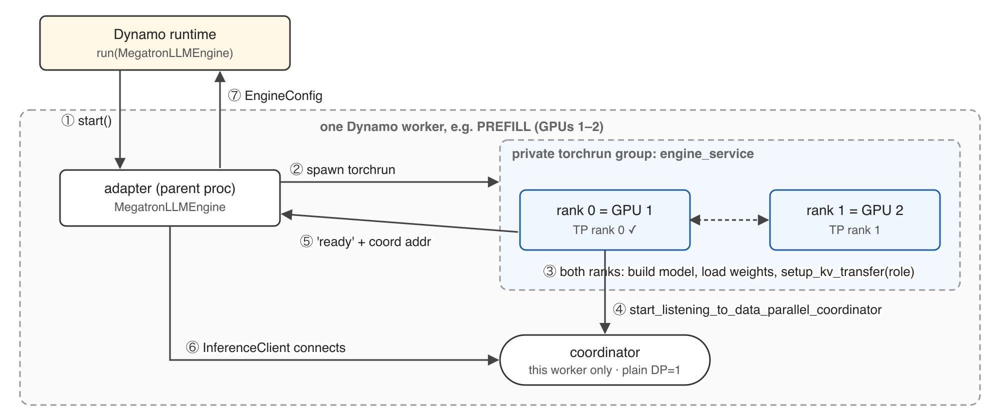
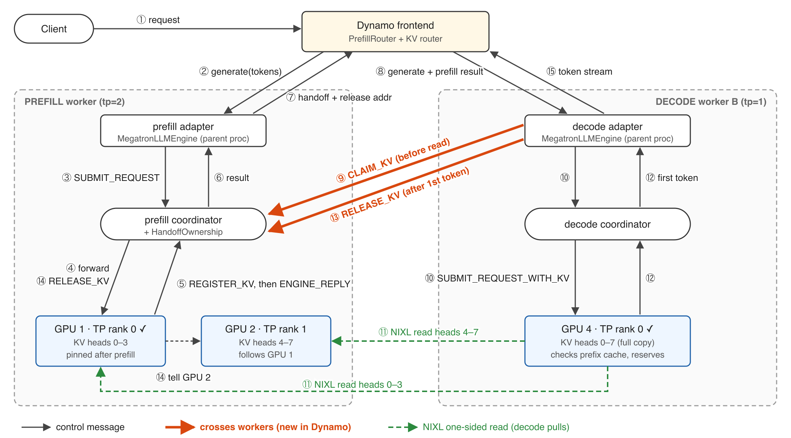
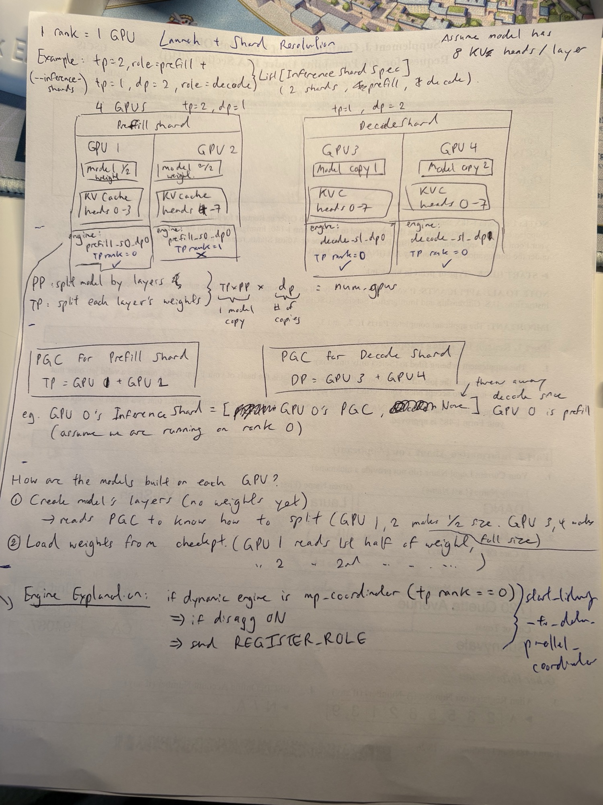
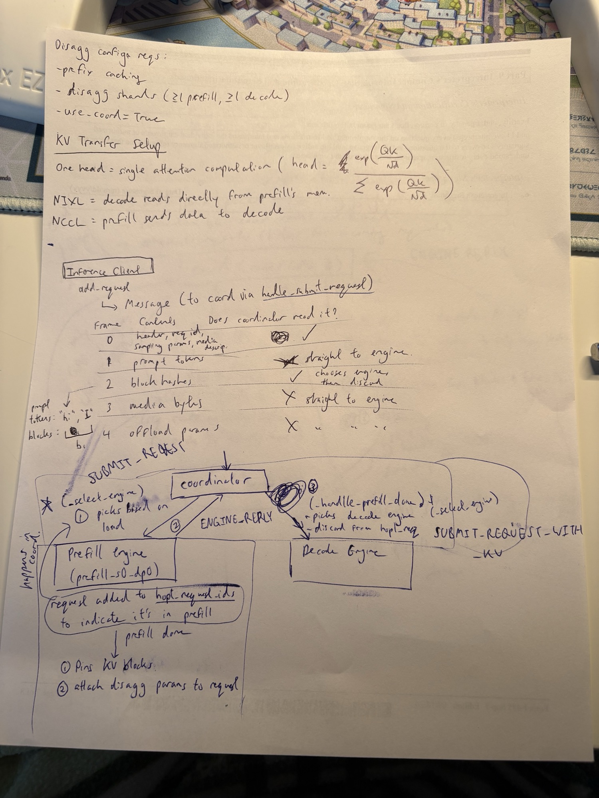
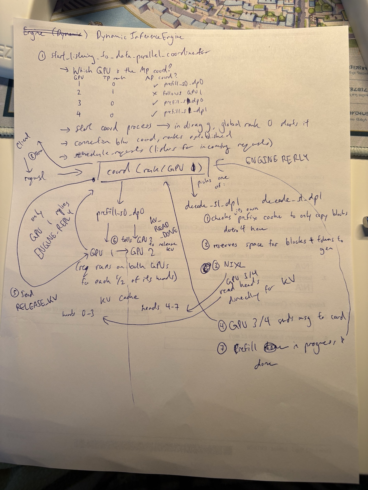

# Disaggregated Inference (Prefill/Decode)

**Disaggregated inference** splits serving into separate **prefill** and **decode** engines on different GPUs, with a coordinator routing each request prefill → decode and the KV cache handed off between them (Megatron `DynamicInferenceEngine`).

> Running example: **4 GPUs**, **1 rank = 1 GPU** (GPUs 1–4 = ranks 0–3), model has **8 KV heads / layer**.

## Launch + shard resolution

```
--inference-shards  "tp=2, role=prefill"  +  "tp=1, dp=2, role=decode"
        ⇒ List[InferenceShardSpec]   (2 shards: 1 prefill, 1 decode)
```

```
        Prefill shard (tp=2, dp=1)                 Decode shard (tp=1, dp=2)
 ┌──────────────────┬──────────────────┐   ┌──────────────────┬──────────────────┐
 │ GPU 1            │ GPU 2            │   │ GPU 3            │ GPU 4            │
 │ model ½ weight   │ model ²⁄₂ weight │   │ model copy 1     │ model copy 2     │
 │ KV heads 0–3     │ KV heads 4–7     │   │ KV heads 0–7     │ KV heads 0–7     │
 │ prefill-s0-dp0   │ prefill-s0-dp0   │   │ decode-s1-dp0    │ decode-s1-dp1    │
 │ TP rank 0  ✓     │ TP rank 1  ✗     │   │ TP rank 0  ✓     │ TP rank 0  ✓     │
 └──────────────────┴──────────────────┘   └──────────────────┴──────────────────┘
                                            ✓ = MP coordinator (runs the engine loop)
```

- **PP** = split model by layers · **TP** = split each layer's weights
- `TP × PP` (= 1 model copy) `× DP` (= # of copies) `= num_gpus`

| Process group collection (PGC) | Groups |
|---|---|
| Prefill shard | TP = GPU 1 + GPU 2 |
| Decode shard  | DP = GPU 3 + GPU 4 |

e.g. on rank 0 (GPU 1): `InferenceShard = [GPU 1's PGC, None]` — decode PGC thrown away since GPU 1 is prefill.

### How models are built on each GPU

1. **Create the model's layers** (no weights yet) → reads PGC to know how to split
   - GPU 1, 2 make ½-size layers · GPU 3, 4 make full-size
2. **Load weights from ckpt**
   - GPU 1 reads 1st half of each weight · GPU 2 reads 2nd half

## Config requirements

- prefix caching
- disagg shards (≥1 prefill, ≥1 decode)
- `use-coord = True`

## KV transfer setup

- **One head** = a single attention computation: `softmax(QKᵀ / √d) · V`
- **NIXL** = decode **reads** directly from prefill's memory (pull)
- **NCCL** = prefill **sends** data to decode (push)

## Engine startup (`DynamicInferenceEngine`)

`start_listening_to_data_parallel_coordinator`:

```
if engine is mp_coordinator (tp rank == 0):
    if disagg ON:
        send REGISTER_ROLE
```

**Which GPU is the MP coordinator?**

| GPU | TP rank | MP coord? |
|---|---|---|
| 1 | 0 | ✓ `prefill-s0-dp0` |
| 2 | 1 | ✗ follows GPU 1 |
| 3 | 0 | ✓ `decode-s1-dp0` |
| 4 | 0 | ✓ `decode-s1-dp1` |

Then:

1. **Start coordinator process** → in disagg, **global rank 0** starts it
2. **Connection** between coordinator ↔ ranks established
3. **`schedule_requests`** → listens for incoming requests

## Client → coordinator message

`InferenceClient.add_request` → `Message` → coordinator (`handle_submit_request`)

| Frame | Contents | Coordinator reads it? |
|---|---|---|
| 0 | header, req id, sampling params, media descriptor | ✓ |
| 1 | prompt tokens | ✗ straight to engine |
| 2 | block hashes | ✓ chooses engine, then discards |
| 3 | media bytes | ✗ straight to engine |
| 4 | offload params | ✗ straight to engine |

> Block hashes: prompt tokens (`"hi"`, `"I"`, …) are chunked into KV blocks; one hash per block.

## Request lifecycle

### Coordinator routing (prefill → decode handoff)



### Full lifecycle across GPUs



## With Dynamo instead of the native coordinator

Same engine-side handoff code (pin on prefill, NIXL pull on decode, admit without replay) — what changes is **who orchestrates it**. Prefill and decode become **independent Megatron deployments** (each with its own torchrun group + coordinator); the **Dynamo frontend** routes and carries the handoff metadata between them.

Same running example, but Dynamo needs **DP=1 per worker** → the decode shard's `dp=2` becomes **two decode workers**:

```
                          Dynamo frontend  (KV router)   ⇄   NATS / etcd
                                │                 │                  │
 ┌──────── PREFILL worker ─────────┐ ┌─ DECODE worker A ─┐ ┌─ DECODE worker B ─┐
 │ --role prefill   tp=2           │ │ --role decode tp=1│ │ --role decode tp=1│
 │ adapter (MegatronLLMEngine)     │ │ adapter           │ │ adapter           │
 │ coordinator  (own, plain DP)    │ │ coordinator (own) │ │ coordinator (own) │
 │ ┌──────────────┬──────────────┐ │ │ ┌───────────────┐ │ │ ┌───────────────┐ │
 │ │ GPU 1        │ GPU 2        │ │ │ │ GPU 3         │ │ │ │ GPU 4         │ │
 │ │ KV heads 0–3 │ KV heads 4–7 │ │ │ │ KV heads 0–7  │ │ │ │ KV heads 0–7  │ │
 │ │ TP rank 0 ✓  │ TP rank 1 ✗  │ │ │ │ TP rank 0 ✓   │ │ │ │ TP rank 0 ✓   │ │
 │ └──────────────┴──────────────┘ │ │ └───────────────┘ │ │ └───────────────┘ │
 └─────────────────────────────────┘ └───────────────────┘ └───────────────────┘
```

|                     | Native                                      | Dynamo                                                        |
| ------------------- | ------------------------------------------- | ------------------------------------------------------------- |
| torchrun worlds     | 1 (GPUs 1–4)                                | **3** (GPUs 1–2, GPU 3, GPU 4)                                |
| Coordinators        | 1, started by global rank 0                 | **3**, one per worker                                         |
| Role setup          | `REGISTER_ROLE`                             | none — `engine.setup_kv_transfer(role)` called directly       |
| Picks prefill/decode | coordinator `_select_engine`               | Dynamo frontend (`PrefillRouter` + KV router fed by prefill KV events) |
| KV transport        | NCCL or NIXL                                | **NIXL only** — workers share no process group                |
| Source release      | decode `KV_READ_DONE` → coord `RELEASE_KV`  | decode adapter sends `RELEASE_KV` to **prefill's** coord after 1st token |
| Who may free blocks | coordinator knows both ends                 | `HandoffOwnership` at prefill coord (offer → claim → release) |
| Crash recovery      | engine death → `DISCONNECT`                 | pins **never** time out; supervisor attests decode is dead    |

### Startup of one worker (×3)



1. Dynamo calls `MegatronLLMEngine.from_args` + `start()`
2. Parent binds a ZMQ PULL, spawns `torchrun ... engine_service`
3. Each rank builds its model (same PGC-based split as native) + `setup_kv_transfer(role)` — **no `REGISTER_ROLE`**
4. Rank 0 starts **this worker's own** coordinator
5. Rank 0 → parent: `ready` + coordinator address
6. Parent's `InferenceClient` connects to that coordinator
7. Parent returns `EngineConfig` (block size, total KV blocks) to Dynamo's KV router

### Request lifecycle (frontend picks decode worker B = GPU 4)



| #   | Arrow                                  | Message                                   | What happens |
| --- | -------------------------------------- | ----------------------------------------- | ------------ |
| ①   | Client → frontend                      | request                                   | |
| ②   | frontend → prefill adapter             | `generate(token_ids)`                     | KV router picks prefill worker by prefix match (replaces `_select_engine`) |
| ③   | prefill adapter → prefill coord        | `SUBMIT_REQUEST`                          | `do_kv_handoff=True`, `num_tokens_to_generate=0` |
| ④   | prefill coord → GPU 1                  | forward                                   | runs on GPU 1 + 2 (½ heads each); prefill done → pin KV, attach disagg params |
| ⑤   | GPU 1 → prefill coord                  | `REGISTER_KV`, **then** `ENGINE_REPLY`    | only GPU 1 replies; ownership offer exists before anyone sees the metadata |
| ⑥   | prefill coord → prefill adapter        | final result                              | |
| ⑦   | prefill adapter → frontend             | chunk(`finish_reason="length"`, disagg params) | adds a **`release` return address** (coord addr + instance id + rid); any other finish_reason skips decode |
| ⑧   | frontend → decode adapter              | `generate(token_ids, prefill_result)`     | Dynamo carries the handoff metadata (native: coordinator builds it) |
| ⑨   | decode adapter ⇒ **prefill** coord     | `CONNECT` + `CLAIM_KV`                    | **crosses workers**; single-use claim, instance id fences a restarted coordinator |
| ⑩   | decode adapter → decode coord → GPU 4  | `SUBMIT_REQUEST_WITH_KV`                  | same frames as native, but to decode's **own** coordinator |
| ⑪   | GPU 4 ⇢ GPU 1 / GPU 2                  | NIXL one-sided READ                       | check own prefix cache → reserve → read heads 0–3 from GPU 1, 4–7 from GPU 2 (TP 2→1 reshard) |
| ⑫   | GPU 4 → decode coord → decode adapter  | `ENGINE_REPLY_PARTIAL` (1st token)        | **no `KV_READ_DONE`** — only sent with native disagg config |
| ⑬   | decode adapter ⇒ **prefill** coord     | `RELEASE_KV(rid, instance_id)`            | **crosses workers**, in background after 1st token; retried every 5 s on failure |
| ⑭   | prefill coord → GPU 1 (→ GPU 2)        | `RELEASE_KV`                              | unpin; GPU 1 tells GPU 2, same as native ⑥ |
| ⑮   | decode adapter → frontend → client     | token stream                              | |

**Diff vs native lifecycle above:**
- Native `handle_prefill_done` → `SUBMIT_REQUEST_WITH_KV` becomes three hops through Dynamo: ⑥ → ⑦ → ⑧.
- Native `KV_READ_DONE` → `RELEASE_KV` becomes ⑨ **claim** before the read + ⑬ **release** after the first token, both sent by the decode adapter straight to the prefill's coordinator.
- ④ / ⑪ / ⑭ (prefill, NIXL pull, GPU 1→2 release) are the **same engine code** as native.

## Original handwritten notes







## Related
- `Machine_Learning/LLMs/Inference/prefill-decode.md` — the prefill vs decode phases this architecture splits apart
- `Work/LLM/nemo-rl-architecture.md` — NeMo-RL uses Megatron inference engines for rollouts
- `Work/LLM/async-grpo-refit-drain.md` — engine drain/refit interacts with in-flight requests
